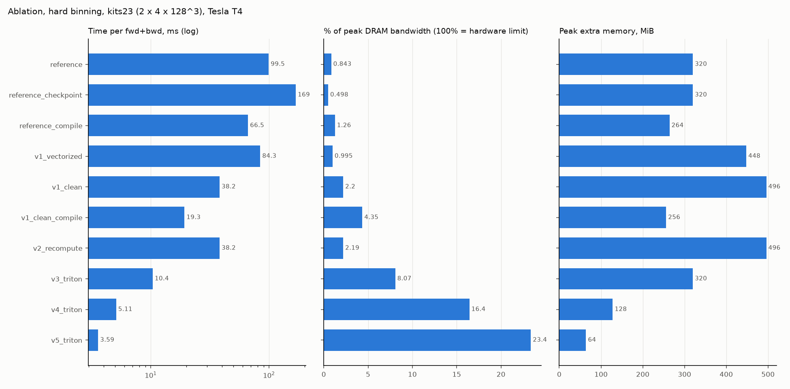
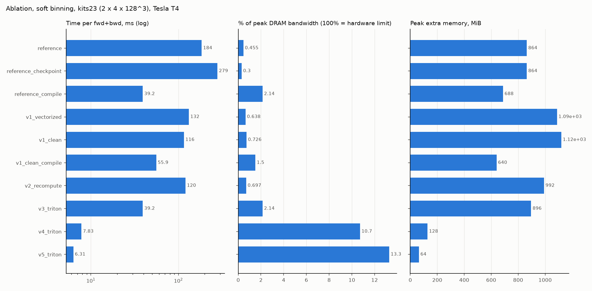

# Ablation (generated by `python -m ace_bench.ablation`)

Tesla T4 (Kaggle), fp32 logits, forward + backward, p50 over 10 calls, paper training shapes (batch 2): kits23 4 x 128^3, acdc17 4 x 256^2 x 16, brats21 4 x 224^2 x 144, amos22 16 x 176^2 x 64. Each cell: most recent valid run of that implementation. Excluded runs: `afa97a0e3643` (Sprint 3 run 4: memory leak in the harness (38 OOM rows)); `967b720e1e11` (Sprint 5+6 run 1: class-presence scatter and grid-limit bugs, superseded by dc02925).

## hard binning: time (speedup vs reference)

| sprint | impl | change | kits23 ms | acdc17 ms | brats21 ms | amos22 ms | % peak BW (kits23) | peak MiB (brats21) | saved MiB (brats21) |
|---|---|---|---|---|---|---|---|---|---|
| S1 | reference | original upstream loss | 99.5 (1.0x) | 50.6 (1.0x) | 351.8 (1.0x) | 803.8 (1.0x) | 0.8 | 1106 | 661.5 |
| S2 | reference_checkpoint | + torch.utils.checkpoint | 168.6 (0.6x) | 85.1 (0.6x) | 587.1 (0.6x) | 1287.5 (0.6x) | 0.5 | 1108 | 0.0 |
| S2 | reference_compile | + torch.compile | 66.5 (1.5x) | 33.1 (1.5x) | 234.5 (1.5x) | 498.8 (1.6x) | 1.3 | 917 | 441.0 |
| S3 | v1_vectorized | B x C loop removed | 84.3 (1.2x) | 41.7 (1.2x) | 307.9 (1.1x) | 598.7 (1.3x) | 1.0 | 1546 | 661.5 |
| S3 | v1_clean | + sums, no one-hot, no host sync | 38.2 (2.6x) | 18.5 (2.7x) | 134.4 (2.6x) | 214.4 (3.7x) | 2.2 | 1712 | 661.5 |
| S3 | v1_clean_compile | + torch.compile | 19.3 (5.2x) | 9.9 (5.1x) | 69.8 (5.0x) | 108.9 (7.4x) | 4.3 | 884 | 441.0 |
| S4 | v2_recompute | handwritten backward (PyTorch) | 38.2 (2.6x) | 18.9 (2.7x) | 139.9 (2.5x) | 232.0 (3.5x) | 2.2 | 1712 | 0.0 |
| S5 | v3_triton | Triton private-histogram forward | 10.4 (9.6x) | 5.2 (9.8x) | 36.0 (9.8x) | 41.9 (19.2x) | 8.1 | 1104 | 0.0 |
| S6/S7 | v4_triton | + Triton backward | 5.1 (19.5x) | 2.5 (20.2x) | 18.7 (18.8x) | 21.2 (37.8x) | 16.4 | 441 | 0.0 |
| S8 | v5_triton | + softmax fused into both kernels | 3.6 (27.7x) | 1.7 (29.2x) | 13.5 (26.0x) | 14.3 (56.2x) | 23.4 | 221 | 0.0 |

## soft binning: time (speedup vs reference)

| sprint | impl | change | kits23 ms | acdc17 ms | brats21 ms | amos22 ms | % peak BW (kits23) | peak MiB (brats21) | saved MiB (brats21) |
|---|---|---|---|---|---|---|---|---|---|
| S1 | reference | original upstream loss | 184.4 (1.0x) | 93.2 (1.0x) | 607.7 (1.0x) | 1492.4 (1.0x) | 0.5 | 3008 | 2425.5 |
| S2 | reference_checkpoint | + torch.utils.checkpoint | 279.2 (0.7x) | 145.6 (0.6x) | 941.2 (0.6x) | 2117.9 (0.7x) | 0.3 | 3008 | 0.0 |
| S2 | reference_compile | + torch.compile | 39.2 (4.7x) | 19.2 (4.9x) | 136.4 (4.5x) | 2693.5 (0.6x) | 2.1 | 2388 | 1157.6 |
| S3 | v1_vectorized | B x C loop removed | 131.6 (1.4x) | 65.4 (1.4x) | 440.1 (1.4x) | 728.5 (2.0x) | 0.6 | 3756 | 2425.5 |
| S3 | v1_clean | + sums, no one-hot, no host sync | 115.5 (1.6x) | 57.0 (1.6x) | 382.5 (1.6x) | 546.1 (2.7x) | 0.7 | 3866 | 2590.9 |
| S3 | v1_clean_compile | + torch.compile | 55.9 (3.3x) | 27.4 (3.4x) | 200.2 (3.0x) | 334.4 (4.5x) | 1.5 | 2206 | 1226.5 |
| S4 | v2_recompute | handwritten backward (PyTorch) | 120.4 (1.5x) | 58.2 (1.6x) | 392.8 (1.5x) | 571.4 (2.6x) | 0.7 | 3424 | 0.0 |
| S5 | v3_triton | Triton private-histogram forward | 39.2 (4.7x) | 19.8 (4.7x) | 135.0 (4.5x) | 151.4 (9.9x) | 2.1 | 3092 | 0.0 |
| S6/S7 | v4_triton | + Triton backward | 7.8 (23.6x) | 3.2 (29.6x) | 26.0 (23.4x) | 29.7 (50.2x) | 10.7 | 441 | 0.0 |
| S8 | v5_triton | + softmax fused into both kernels | 6.3 (29.2x) | 2.5 (37.7x) | 20.8 (29.2x) | 22.5 (66.3x) | 13.3 | 221 | 0.0 |

## Predicted floors vs measured, hard, kits23

| impl | measured ms | bandwidth floor ms | x above floor | kernels / call | launch floor ms |
|---|---|---|---|---|---|
| reference | 99.45 | 0.84 | 118.6 | 428 | 2.14 |
| reference_checkpoint | 168.56 | 0.84 | 200.9 | 675 | 3.38 |
| reference_compile | 66.49 | 0.84 | 79.3 | 171 | 0.85 |
| v1_vectorized | 84.34 | 0.84 | 100.5 | 78 | 0.39 |
| v1_clean | 38.2 | 0.84 | 45.5 | 67 | 0.34 |
| v1_clean_compile | 19.29 | 0.84 | 23.0 | 13 | 0.07 |
| v2_recompute | 38.24 | 0.84 | 45.6 | 82 | 0.41 |
| v3_triton | 10.4 | 0.84 | 12.4 | 63 | 0.32 |
| v4_triton | 5.11 | 0.84 | 6.1 | 59 | 0.29 |
| v5_triton | 3.59 | 0.84 | 4.3 | 57 | 0.28 |

## Predicted floors vs measured, soft, kits23

| impl | measured ms | bandwidth floor ms | x above floor | kernels / call | launch floor ms |
|---|---|---|---|---|---|
| reference | 184.36 | 0.84 | 219.8 | 981 | 4.91 |
| reference_checkpoint | 279.23 | 0.84 | 332.9 | 1396 | 6.98 |
| reference_compile | 39.17 | 0.84 | 46.7 | 83 | 0.41 |
| v1_vectorized | 131.56 | 0.84 | 156.8 | 129 | 0.65 |
| v1_clean | 115.55 | 0.84 | 137.7 | 149 | 0.74 |
| v1_clean_compile | 55.89 | 0.84 | 66.6 | 24 | 0.12 |
| v2_recompute | 120.37 | 0.84 | 143.5 | 151 | 0.76 |
| v3_triton | 39.17 | 0.84 | 46.7 | 103 | 0.52 |
| v4_triton | 7.83 | 0.84 | 9.3 | 67 | 0.34 |
| v5_triton | 6.31 | 0.84 | 7.5 | 65 | 0.33 |

## Accuracy vs float64 truth (latest verification run)

| impl | binning | max loss err vs fp64 |
|---|---|---|
| reference | hard | 1.1e-04 |
| v4_triton | hard | 1.1e-04 |
| v5_triton | hard | 3.0e-07 |
| reference | soft | 4.5e-05 |
| v4_triton | soft | 4.1e-06 |
| v5_triton | soft | 4.3e-07 |

## Runs used

| run | commit |
|---|---|
| 20261025T195519Z-baseline-paper | fb8ebdca9b33 |
| 20261025T201009Z-baseline-scaling | fb8ebdca9b33 |
| 20261025T221628Z-sprint3-paper | 33facc78d8f3 |
| 20261025T224028Z-sprint3-scaling | 33facc78d8f3 |
| 20261026T145009Z-sprint4-paper | a2696e81824d |
| 20261026T150755Z-sprint4-memory | a2696e81824d |
| 20261026T170611Z-sprint56-paper | dc029258d7b6 |
| 20261026T171324Z-sprint56-scaling | dc029258d7b6 |
| 20261026T184829Z-sprint7-paper | 5423f093984d |
| 20261026T190428Z-sprint7-memory | 5423f093984d |
| 20261026T203820Z-sprint8-paper | 1ab2f019d85e |
